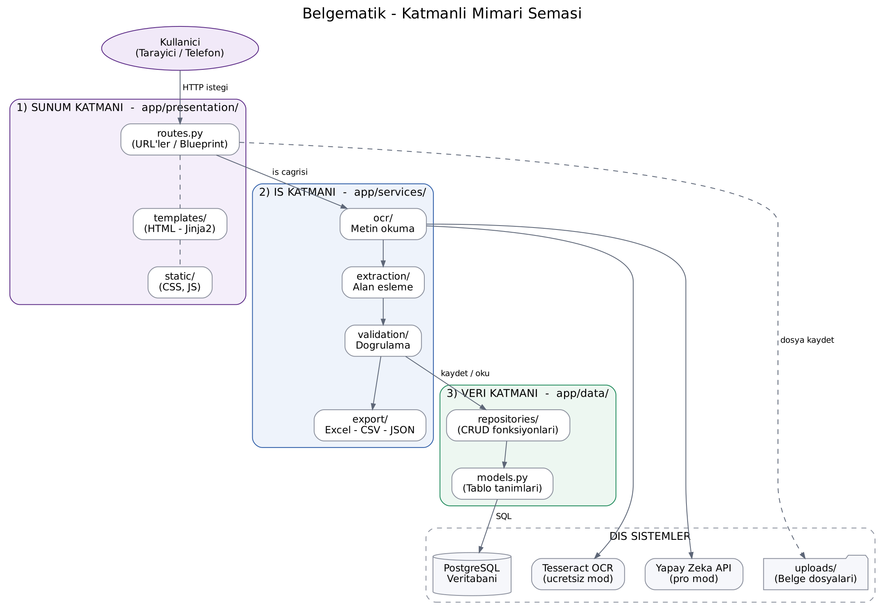
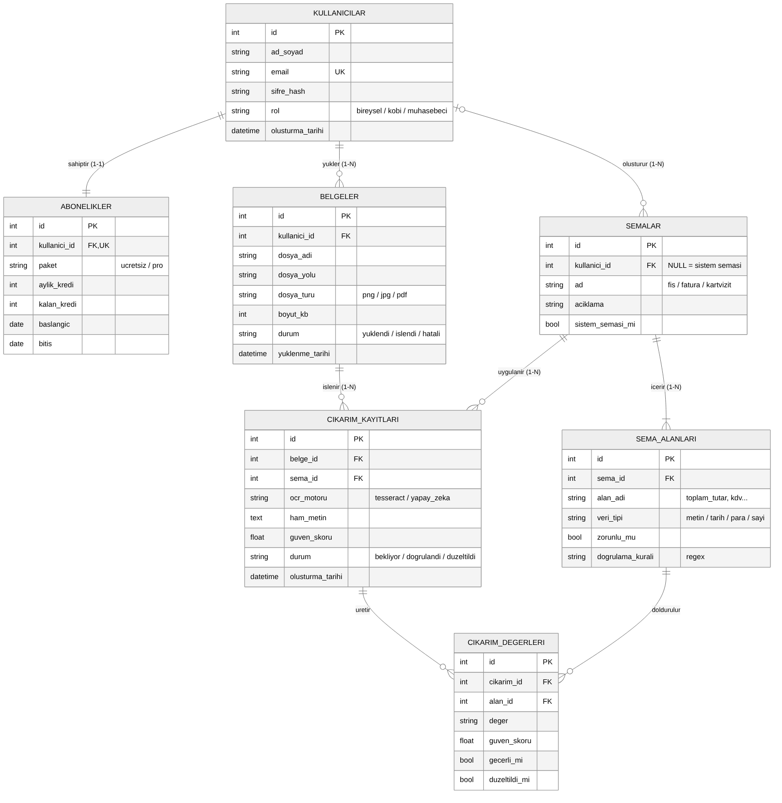

# Belgematik

**Fiş, fatura ve kartvizit fotoğraflarından yapılandırılmış veri (JSON / tablo) çıkaran web uygulaması.**

KOBİ'ler ve muhasebeciler her ay yüzlerce belgeyi elle sisteme giriyor. Bu hem yorucu hem de hataya açık.
Belgematik belgenin fotoğrafını alır, OCR ve yapay zekâ ile alanları (firma, vergi no, tarih, KDV, toplam…)
çıkarır, kurallarla doğrular ve sonucu Excel / CSV / JSON olarak verir.

> Durum: **v0.1 – Proje iskeleti (Hafta 3)**. Modüller haftalık olarak eklenmektedir.

## Özellikler (yol haritası)

| Modül | Açıklama | Durum |
|---|---|---|
| Proje iskeleti | Katmanlı mimari, yapılandırma, testler | ✅ Hafta 3 |
| Veritabanı | PostgreSQL tabloları ve CRUD | ⏳ Hafta 4 |
| Fotoğraf yükleme | PNG / JPG / PDF yükleme ve ön işleme | ⏳ |
| OCR | Tesseract (ücretsiz) + Yapay zekâ (pro) | ⏳ |
| Alan eşleme ve doğrulama | Şema ve iş kuralı kontrolü | ⏳ |
| Düzeltme arayüzü | Hatalı alanları ekranda düzeltme | ⏳ |
| Dışa aktarma | Excel, CSV, JSON | ⏳ |

## Teknolojiler

Python 3.12 · Flask · PostgreSQL · Tesseract OCR · Görsel destekli LLM API · Pydantic · Bootstrap · Git/GitHub

## Mimari

Proje **3 katmanlı mimari** ile geliştirilmektedir:

```
app/
├── presentation/   # 1) SUNUM katmanı : URL'ler, HTML sayfalar, CSS
├── services/       # 2) İŞ katmanı    : OCR, alan eşleme, doğrulama, dışa aktarma
│   ├── ocr/
│   ├── extraction/
│   ├── validation/
│   └── export/
└── data/           # 3) VERİ katmanı  : Veritabanı modelleri ve veri erişimi
    ├── models.py
    └── repositories/
```



## Veri modeli (ER diyagramı)



Tabloların ve ilişkilerin açıklaması: [docs/veri-modeli.md](docs/veri-modeli.md)

## Kurulum (Windows)

```powershell
git clone https://github.com/hasankamiloglu/belgematik.git
cd belgematik
py -m venv venv
venv\Scripts\activate
pip install -r requirements.txt
copy .env.example .env
python run.py
```

Tarayıcıda aç: http://127.0.0.1:5000

Testleri çalıştırmak için: `pytest`

Ayrıntılı kurulum: [docs/kurulum-windows.md](docs/kurulum-windows.md)

## Proje klasör yapısı

```
belgematik/
├── app/               # Uygulama kodu (3 katman)
├── tests/             # Otomatik testler
├── uploads/           # Yüklenen belgeler (Git'e gitmez)
├── docs/              # Diyagramlar, kurulum ve haftalık raporlar
├── config.py          # Ortam ayarları (geliştirme / test / canlı)
├── run.py             # Uygulamayı başlatan dosya
├── requirements.txt   # Python kütüphaneleri
├── .env.example       # Örnek gizli ayar dosyası
└── .gitignore         # Git'e gönderilmeyecek dosyalar
```

## Lisans

Bu proje Bilgisayar Uygulamaları I dersi kapsamında geliştirilmektedir.
